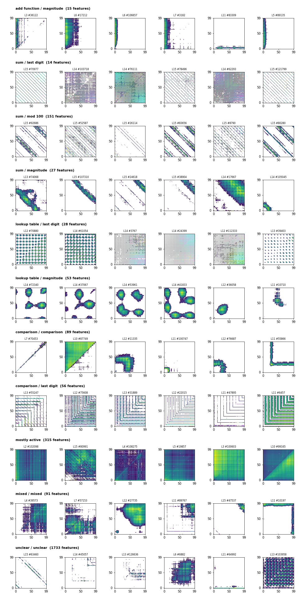
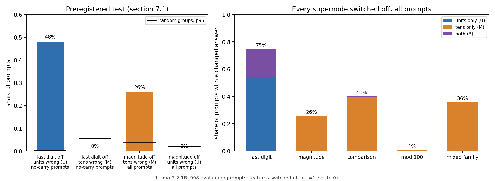
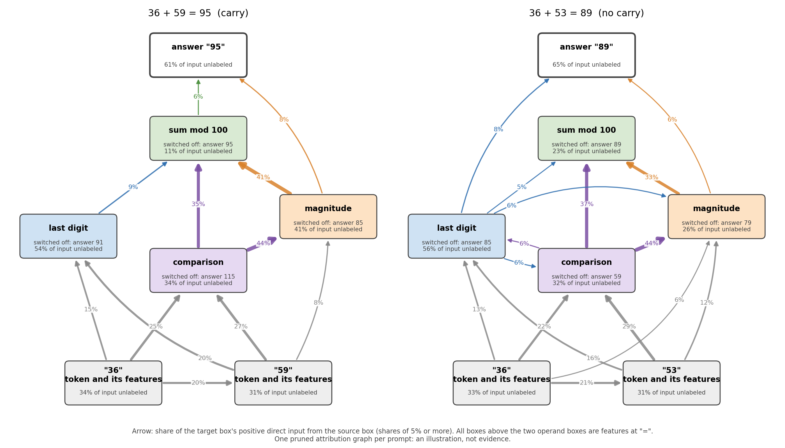
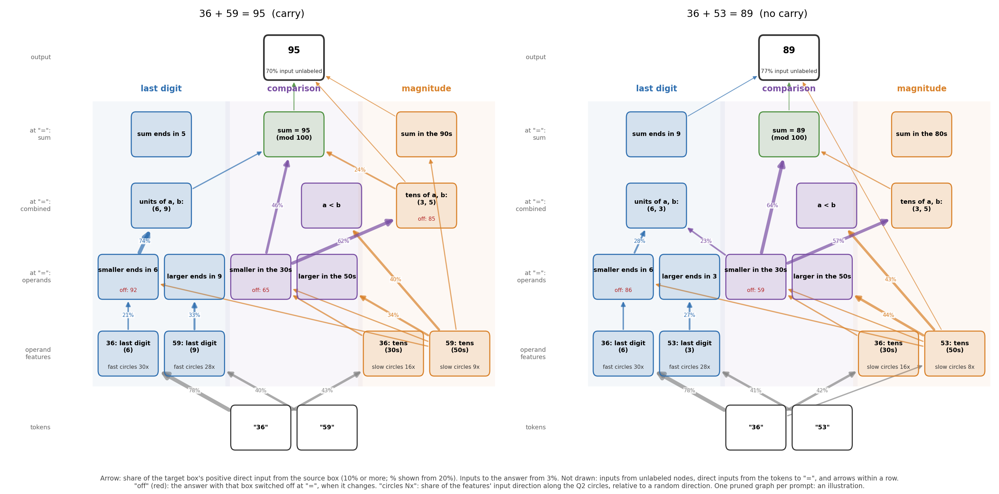
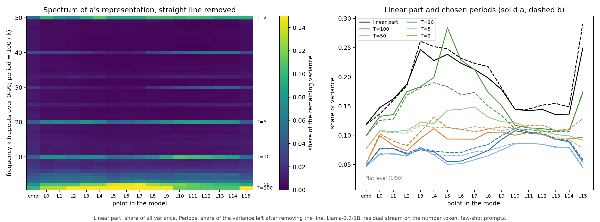
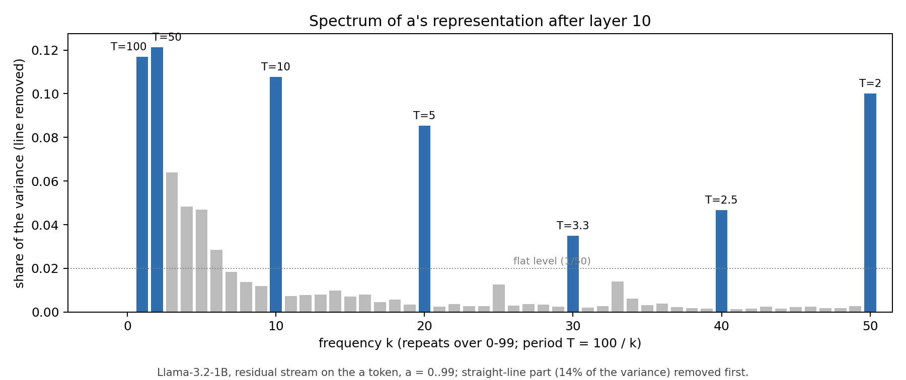
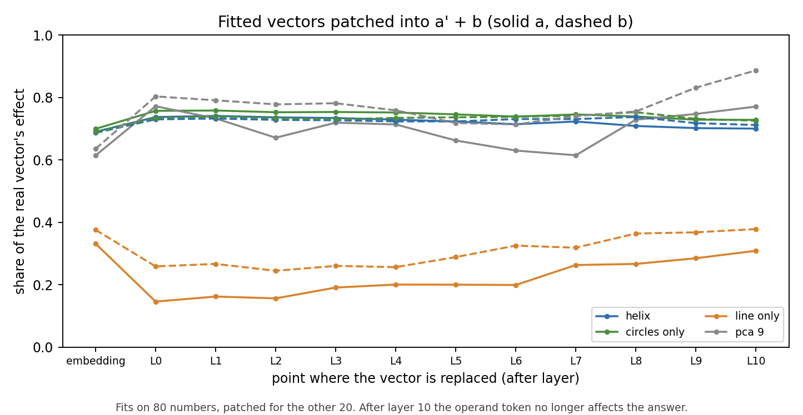
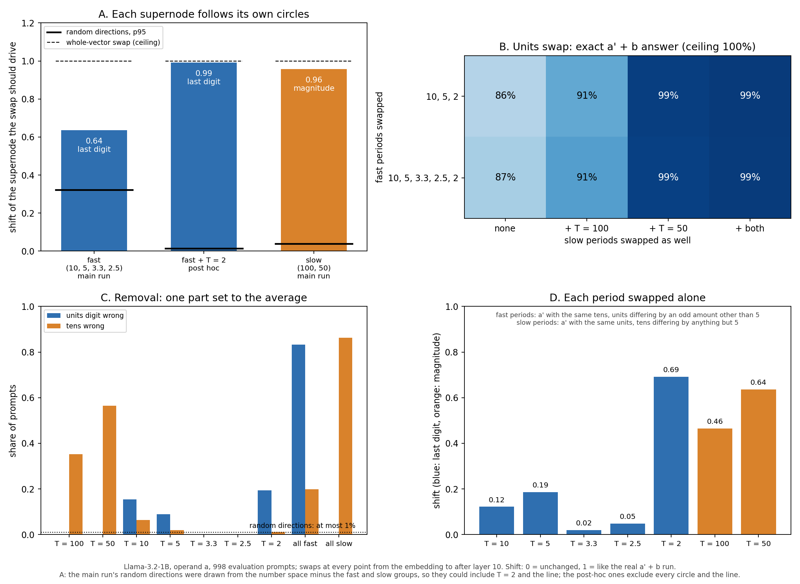

# Results

Model: Llama-3.2-1B in float16, with the transcoders `mntss/transcoder-Llama-3.2-1B`
(16 layers, 131,072 features per layer), loaded through circuit-tracer v0.5.3.

Every experiment below was designed and its decision rules written down before
it ran. Runs decided afterwards are marked **post hoc**; they are reported, but
no claim rests on them alone.

## Contents

1. [Prompts and clean accuracy](#1-prompts-and-clean-accuracy)
2. [Feature labels](#2-feature-labels)
3. [Q1: separate pathways?](#3-q1-separate-pathways)
4. [Q1: attribution graphs](#4-q1-attribution-graphs)
5. [Q2 step 1: how the model represents numbers](#5-q2-step-1-how-the-model-represents-numbers)
6. [Q2: which circles each pathway uses](#6-q2-which-circles-each-pathway-uses)
7. [Q2: the carry](#7-q2-the-carry)
8. [Comparison with Kantamneni and Tegmark](#8-comparison-with-kantamneni-and-tegmark)
9. [Limits](#9-limits)
10. [Open questions](#10-open-questions)

## 1. Prompts and clean accuracy

Every prompt has a fixed 4-example prefix and one question:

```
calc: 31+45=76
calc: 17+29=46
calc: 52+86=138
calc: 63+78=141
calc: 36+59=
```

with $a, b \in \{0, \dots, 99\}$ (9,992 pairs; the 4 prefix pairs and their
swaps are left out). Each prompt is 44 tokens; $a$ is at position 40, $b$ at
42 and "=" at 43. The answer is read greedily (up to 4 tokens) and compared
digit by digit with $a + b$:

| | tens and above same | tens and above changed |
|---|---|---|
| **units same** | N (no change) | M (tens only) |
| **units changed** | U (units only) | B (both) |

X marks an output that does not start with a number. It never occurred.

Clean accuracy: 99.75% (`clean_accuracy/`). All 25 wrong answers are exactly
10 too high (units right), with true sums between 127 and 143. Without the
prefix the accuracy is similar (99.77%, `clean_accuracy_zeroshot/`) but the
errors are more varied. The evaluation set is 1,000 sampled pairs (half with a
carry) minus the 2 the model gets wrong: 998 prompts.

## 2. Feature labels

At "=", 10,839 features are active on at least one prompt; 5,043 are active
on at least 20 and were scored (`feature_scores/`).

**Score.** For a feature with activation $f$ and a candidate variable $v$
(for example the units digit of the sum), the prompts are grouped by the value
of $v$ and

$$R^2 = 1 - \frac{\sum_{\text{prompts}} \big(f - \bar f_{v}\big)^2}{\sum_{\text{prompts}} \big(f - \bar f\big)^2},$$

where $\bar f_{v}$ is the mean activation within the prompt's group. $R^2$ is
computed on the activation values and on the on/off pattern, against a library
of variables (operand and sum digits, ranges, comparisons, max/min, sum modulo
100). A feature is labeled when its best variable reaches $R^2 \ge 0.6$ and
leads the next by at least 0.15. Features active on more than 90% of prompts
are labeled "mostly active".

Each label has a **role** (add function, lookup table, sum, comparison) and a
**family** (last digit, magnitude, mod 100, comparison).



**Checks.** Two blind checks: labels hidden, features labeled by hand from
their operand plots, codebook in `blind_check/codebook.md`. Agreement on the
role: 77% (75 features) and 73% (30 harder features). Two manual reviews
(criteria in `manual_review/criteria.md`): the "tens (a, b)" lookup tables
(53 kept, 92 dropped) and the add function features (15 kept, 26 dropped).
Examples of every category: `../figures/taxonomy/taxonomy.pdf`.

**Final labels** (`feature_labels/`): 145 comparison, 233 sum, 81 lookup
table, 15 add function, 104 mixed, 315 mostly active, 4,150 unclear. The
labels favor precision: a feature whose pattern is unclear stays unlabeled.
The 578 features in the supernodes below are about 11% of the scored features
and hold about 43% of the activation at "=".

**Supernodes** (one per family, all roles together):

| Supernode | Features | Main parts |
|---|---|---|
| last digit | 108 | 56 "max or min of the units" features, 28 lookup, 14 sum |
| magnitude | 98 | 53 hand-checked lookup tables, 27 sum, 15 add function |
| comparison | 89 | features such as $a < b$ |
| mod 100 | 151 | sum features for the last two digits |
| mixed family | 132 | features matching more than one family |

## 3. Q1: separate pathways?

**Method.** A supernode's features are switched off at "=" (activation set to
0, with live attention) on all 998 prompts. Controls: 100 random groups per
supernode, with the same number of features per layer, drawn from the scored
features that are not mostly active and never containing the supernode's own
features (`q1_runs/`, `q1_analysis/`).

**Rule.** The last-digit supernode must change the units on no-carry prompts
more often than 95% of random groups, and the tens no more often. The
magnitude supernode must do the opposite on all prompts.



| Switched off | Intended digit changed | Random p95 | Other digit changed | Random p95 |
|---|---|---|---|---|
| last digit (no-carry) | U 48.0% [43.6, 52.4] | 0.2% | M 0.0% | 5.6% |
| magnitude (all) | M 25.9% [23.4, 28.6] | 2.0% | U 0.0% | 3.6% |

Brackets: 95% bootstrap intervals. **The rule passes.**

Internal test: switching off last digit changes the magnitude features' summed
activation by 12.05% (random p95 11.98%), a narrow fail; the other direction
passes (3.4% vs 5.7%). Preregistered wording of the result: *the supernodes
affect different digits, and interact internally*.

Other results:
- Carry: with last digit off, both digits change on 26.6% of carry prompts
  and 14.5% of no-carry prompts (difference 6.9 to 17.3 points, 95% interval).
- Without its 56 "max or min of the units" features, the last-digit
  supernode changes the units on only 9.4%: those features carry most of
  the effect.
- Without its 53 hand-checked lookups, the magnitude supernode has almost no
  effect (0.2%).
- With looser labels ($R^2 \ge 0.5$, no manual review) both supernodes pass.
- Comparison off changes the tens on 40% of prompts, mixed family on 36%,
  mod 100 on 1%.

**Follow-up: the other tens groups** (after the main results; `q1_tens_runs/`,
`scripts/q1_tens_analysis.py`). Comparison, mixed family, and the three tens
groups together (magnitude + comparison + mixed family, 319 features), each
against 100 random groups built the same way, on all prompts.

| Switched off | M | Random p95 | U | Random p95 |
|---|---|---|---|---|
| comparison | 39.8% | 0.5% | 0.0% | 27.4% |
| mixed family | 35.9% | 5.0% | 0.0% | 1.5% |
| tens combined | 72.3% | 3.3% | 0.1% | 28.1% |

All three change the tens far more than random groups and leave the units
alone. Together they change the tens on 72% of prompts, against 26 to 40% for
each group alone.

The random p95 for U is high for comparison and for the combined group. The
random pool excludes only the group's own features, so it can draw features of
the other families. One last-digit feature (layer 11, #113488, "units of the
smaller operand", $R^2 = 0.998$) changes the units on 27 to 38% of prompts
whenever it is drawn: in 6 of the 100 comparison groups, 11 of the combined
groups and 2 of the mixed-family groups. Without the groups that contain it,
the U p95 is 0.7% for comparison, 7.3% for the combined group and 1.3% for
mixed family. The real groups change the units on 0 to 0.1%.

## 4. Q1: attribution graphs

200 attribution graphs (100 carry, 100 no-carry; `q1_graphs/`). Replacement
score 0.67, completeness 0.93. The share of influence on the answer that
passes through the five supernodes is 13%, through mostly active features at
"=" 15%, through features at earlier positions 37%. A node's influence counts
every path through it, so earlier nodes collect credit for everything after
them; these shares are a rough guide to coverage only.

Per source feature, the direct input from last digit to magnitude (0.0010) is
about 5 times that from magnitude to last digit (0.0002), the same direction
as the internal test.

**Path diagram** for one carry and one no-carry prompt (`path_diagram/`). Each
box is a group of nodes from the pruned graph; an arrow is the share of the
target box's direct input coming from the source box. The "switched off"
lines are real interventions on that prompt.



The diagram is an illustration of one prompt each. About 60% of the answer's
direct input comes from mostly active and unclear features and from error
nodes.

**Finer boxes** (`path_diagram/operand_features.csv`,
`path_diagram/box_interventions.csv`, notebook 12). Features on the operand
tokens are labeled by the property of the number they track (size or tens,
units, parity, mod 5; same $R^2$ rule as above). Features at "=" are grouped
by the variable they track. "off" gives the answer with that box switched off
on this prompt.



- The operand features that track the tens have 8 to 16 times more of their
  input direction along the slow circles than a random direction; those that
  track the last digit, 28 to 30 times more along the fast circles. This links
  the Q2 circles to individual features.
- On 36 + 59, switching off "smaller ends in 6" gives 92 (units change),
  "tens of a, b" gives 85 and "smaller in the 30s" gives 65 (tens change).
  On 36 + 53, "smaller ends in 6" gives 86 and "smaller in the 30s" 59. The
  other boxes leave the answer unchanged on their own.
- The main routes run from the operand features through the min/max boxes
  ("smaller ends in 6", "smaller in the 30s") to the lookups and to
  "sum mod 100". 70 to 77% of the answer's direct input still comes from
  unlabeled nodes.

## 5. Q2 step 1: how the model represents numbers

For each number $n = 0, \dots, 99$, the residual stream on the number's token
was collected at 17 points: the embedding and after each of the 16 layers
(`number_acts/`). For $b$, the vector is the mean over 20 prompts with
different $a$, since $b$'s token can see $a$.

**Spectrum.** After removing the straight-line part, the Fourier spectrum over
$n$ has clear peaks at periods $T = 100, 50, 10, 5, 3.3, 2.5$ and $2$
(`number_spectrum/`).





The straight line and $T = 100$ account for the largest share of the
differences between numbers at layers 3 to 5; $T = 10$ and $T = 5$ reach a
similar share at layers 9 to 12. These are shares of variance, which do not
show what the model uses.

**Helix fit.** Each number's vector is modeled as

$$x_n \approx \mu + C^\top B(n), \qquad B(n) = \Big(n,\ \cos\tfrac{2\pi n}{T_1},\ \sin\tfrac{2\pi n}{T_1},\ \dots,\ \cos\tfrac{2\pi n}{T_k},\ \sin\tfrac{2\pi n}{T_k}\Big),$$

where $\mu$ is the mean vector over the 100 numbers and $C$ is fitted by least
squares, separately at every point. The cos and sin rows of $C$ for one period
span that period's **circle**. The circles rotate across layers: the
directions after layer 0 share about 20% with those at the embedding, and
neighbouring later layers share 50 to 80%.

**Does the fit keep what the model needs?** Following Kantamneni and Tegmark:
run $a' + b$, replace the vector on $a'$'s token by the fitted vector of the
clean $a$, and measure the clean answer's logit difference as a share of what
the real vector of $a$ gives. Fits use 80 numbers; only the other 20 are
patched (`helix_patching_corrupted/`).



The helix (line and $T = 2, 5, 10, 100$) keeps 69 to 74% of the real vector's
effect; the circles alone the same; the line alone 15 to 38%; 9 PCA
directions 61 to 89%. About 80% of the top 9 PCA directions lie inside the
helix directions (random directions: 0.5%). After layer 10 the operand's
vector matters little: after layer 11 the real vector's effect is under 8% of
its earlier size, and about 0 from layer 14. By then the number has been
copied to "=".

**Which periods.** Three period sets were compared by the share of variance
they explain on held-out numbers: fit on 80 numbers, tested on the other 20,
10 random splits, mean over the points up to after layer 10
(`period_sets/`, `scripts/period_sets.py`).

| Periods (with the line) | $a$ | $b$ |
|---|---|---|
| $T = 100, 10, 5, 2$ (Kantamneni and Tegmark) | 0.32 | 0.30 |
| $T = 100, 50, 10, 5, 2$ | 0.44 | 0.41 |
| all 7 | 0.43 | 0.42 |

Adding $T = 50$ raises the share by about 0.12. Adding $T = 3.3$ and $2.5$ on
top changes it by less than 0.01. The fit leaves about half of the
variance unexplained at every point. The swaps in section 6 point the same
way: $T = 3.3$ and $2.5$ add nothing to the answer.

## 6. Q2: which circles each pathway uses

**Swap.** On the operand's token, at every point from the embedding to after
layer 10, the vector's part along a group of circle directions $D$ is taken
from another number $a'$:

$$x \leftarrow x - D^\top D\,(x - x_{a'}),$$

with the rows of $D$ orthonormal and $x_{a'}$ the collected vector of $a'$ at
that point. Everything outside $D$ stays as it was.

- **Fast swap**: $a'$ has the same tens digit and different units, with the
  same carry status. Prediction: units become those of $a' + b$.
- **Slow swap**: $a'$ has the same units and a different tens digit.
  Prediction: the tens change.

**Shift.** For a supernode with feature activations $s$ at "=":

$$\text{shift} = \frac{(s_{\text{swap}} - s_{\text{clean}}) \cdot (s_{\text{target}} - s_{\text{clean}})}{\lVert s_{\text{target}} - s_{\text{clean}} \rVert^2},$$

where $s_{\text{target}}$ comes from the real $a' + b$ run. 0 means unchanged,
1 means the supernode looks like it does on $a' + b$. Floor: random directions
in the space the number vectors span. Ceiling: swapping the whole vector.

**Preregistered run** (`q2_runs/`, `q2_analysis/decisions.csv`; groups: fast
$T = 10, 5, 3.3, 2.5$; slow $T = 100, 50$):

| Swap | Supernode | Shift | Random p95 | Exact $a' + b$ answer |
|---|---|---|---|---|
| fast | last digit | 0.64 (a), 0.63 (b) | 0.32 | 40% |
| slow | magnitude | 0.96 (a), 0.95 (b) | 0.04 to 0.05 | 95 to 96% |

The primary rule passes for both operands. The secondary rule (the other
supernode moves no more than random) is crossed in 3 of 4 cases, by 0.003 to
0.020 above the random p95, small next to the main effects.

**Descriptive and post-hoc runs** (`q2_descriptive/`, `q2_posthoc/`):



- **Period 2 belonged in the fast group** (post hoc). $T = 2$ is a harmonic of
  period 10, like 3.3 and 2.5, and had been left out. Swapped alone it moves
  the last-digit supernode as far as the whole fast group (0.69). With it, the
  fast swap reaches a shift of 0.99 and the exact answer on 87 to 89% of
  prompts; random directions of the same size give 0.01 and 0%.
- **Grid** (post hoc, panel B): adding $T = 50$ to the fast swap raises the
  exact answer from 87 to 89% to 99%. Swapping all circles gives 99 to 100%,
  the whole vector 98 to 100%.
- **Removal** (post hoc, panel C): setting one part to its average breaks the
  matching digit only. All fast circles: units wrong on 80 to 83%. Both slow
  circles: tens wrong on 80 to 86%. Each fast period alone: 7 to 20%.
  $T = 50$ alone: 52 to 57%; $T = 100$ alone: 35 to 37%.
  $T = 3.3$, $T = 2.5$ and random directions: about 0.
- **Clamp**: holding the last-digit supernode at its clean values during the
  fast swap lowers the exact $a' + b$ answer from 40% to 5 to 6%. The units change
  passes through that supernode.
- The **comparison** supernode follows the slow circles (shift 0.92).
- A swap at **any single point** from the embedding to after layer 10 gives
  most of the effect: shift 0.51 to 0.58 for the fast swap (0.64 at all
  points) and 0.66 to 0.86 for the slow swap (0.96 at all points).
- The main run's random floor for the fast swap (0.32) was high because its
  random directions could include $T = 2$ and the line; a floor that excludes
  every circle and the line is 0.01.

**Summary.** The last-digit supernode depends on the fast circles
($T = 10, 5, 2$) and the magnitude supernode on the slow circles
($T = 100, 50$). Taken together, the circles hold nearly everything the two
supernodes read from the operand.

## 7. Q2: the carry

Carry-flip swaps (post hoc, `q2_carry/`): same tens, units changed so that the
carry flips (for example 36 to 39 in 36 + 52).

| Swapped | Units follow | Tens follow the new carry |
|---|---|---|
| fast + $T = 2$ | 99.9% | 56 to 57% |
| + $T = 100$ | 99.9% | 68 to 69% |
| + $T = 50$ | 100% | 96 to 99% |
| all circles | 99.9% | 97 to 99% |
| whole vector | 100% | 99 to 100% |

With only the fast circles and $T = 2$ swapped, the slow circles still encode
the old number, and the tens follow the new carry on 56 to 57% of prompts.
Without any carry information from the fast side this would be near 0%. Once
$T = 50$ is swapped as well, so that both sides agree, the tens follow on 96 to
99%. The carry is therefore available from two sources: the units information
(the fast circles, directly or through the last-digit features) and the fine
position on the slow circles, mainly $T = 50$, which also changes with the
units digit. When the two disagree, the tens follow each about half the time.
This fits Q1, where switching off the last-digit supernode changed both digits
more often on carry prompts (27% vs 15%). Which of the two routes the model
relies on when they agree is not tested here.

## 8. Comparison with Kantamneni and Tegmark

| | This model | Their GPT-J (from their Table 1) |
|---|---|---|
| Helix patched into $a' + b$, share of the real vector | about 0.69 to 0.74 (held-out numbers) | about 0.86 |
| Weakest point | the embedding (0.69) | layer 0's input |

The same periods appear ($T = 2, 5, 10, 100$, here also 50). Patching vectors
built from only part of the helix (post hoc): all circles 0.98 to 1.00 of the
real vector's effect, fast part 0.36 to 0.51, slow part 0.41 to 0.44, single
periods 0.06 to 0.44. These fits include the patched numbers, so they are
upper bounds. A vector made of only part of the helix does not look like any
real number, and the model usually gets both digits wrong with it.

## 9. Limits

- **Labels set the scope.** Supernodes were defined from variables chosen in
  advance, and the claims are about those features. Most features at "="
  (by count) are unlabeled, and the unlabeled ones carry a measurable share of
  the computation.
- **One model and one prompt format.**
- **Fitted directions.** The circles come from a least-squares fit; structure
  outside the helix could matter in ways these tests do not show.
- **Post-hoc results** (period 2, grid, removal, carry) were decided after the
  preregistered runs.
- **Path diagram**: one prompt each, an illustration.

## 10. Open questions

- Do the features combine the operands by adding angles (Kantamneni and
  Tegmark's Clock), or by lookup tables over ranges? Testing for a helix of
  the sum at "=" would help separate the two.
- Do the same groups appear when features are clustered without labels?
- How much does each carry route contribute on its own? A test: the
  all-circles carry flip with the last-digit supernode held at its clean
  values.
- Finer supernodes (role and family together, as in Anthropic's diagrams)
  would show the stages inside each pathway.
- The same tests on the zero-shot prompt.
